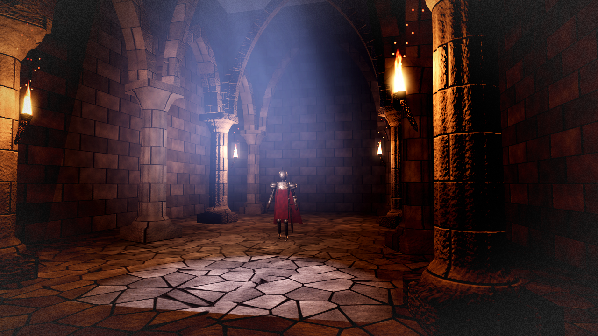
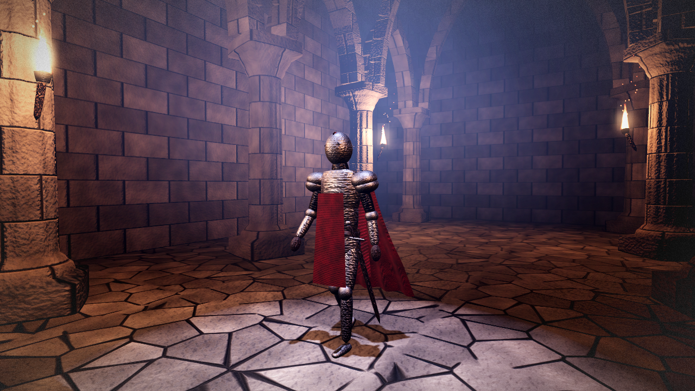
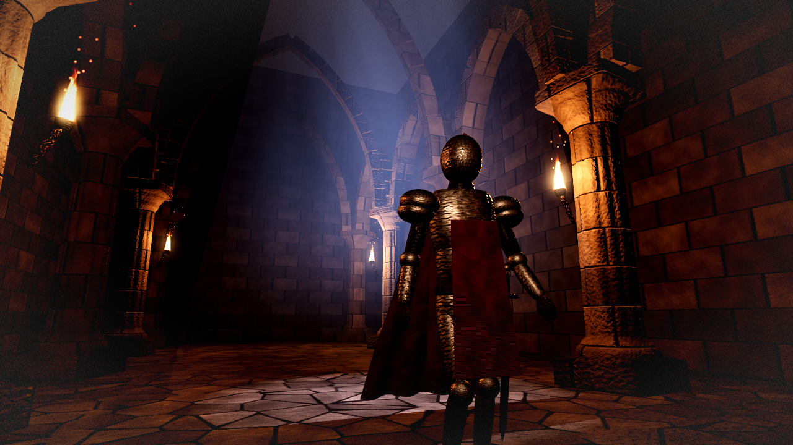

# Vigil Crypt



Vigil Crypt is a moonlit gothic crypt with a walking armoured knight, built in Godot 4.7.2 with **zero asset files**: no images, models, audio, fonts or `.gdshader` files. Every texture, mesh, material, light and sound is generated at startup from about 890 lines of GDScript. It's a Godot take on the approach used by [The Ninth Vigil](https://github.com/iamlukethedev/The-Ninth-Vigil), a Three.js game that generates all of its content in code.

## Features

- **Generated textures** (`texgen.gd`): seamless `FastNoiseLite` fields become albedo and roughness maps, with Sobel-filtered normal maps for ashlar, flagstone, steel, cloth and wood.
- **Parametric geometry** (`geo.gd`): patches are built with `SurfaceTool`, with numeric normals and optional skin weights.
- **A skinned knight** (`knight.gd`): a `Skeleton3D` built from a joint table, skinned armour plates, a walk cycle in code and a spring-driven cape.
- **Architecture and mood** (`main.gd`): lathed fluted columns, pointed-arch voussoirs with MultiMesh, shader flames, CPU-particle embers, flickering torch lights, a faked volumetric moon shaft, ACES tonemapping, glow and fog, vignette and grain.
- **Synthesised audio:** the soundtrack is generated in code into an `AudioStreamWAV`.
- Runs on the Compatibility renderer, so it also exports to the web.

| Knight | Close-up |
|---|---|
|  |  |

## How to run

You need [Godot 4.7.2](https://godotengine.org/download). The project uses the Compatibility renderer.

```bash
# run it
godot --path .

# record the 8-second clip and the three stills into out/ (headless Linux example)
xvfb-run -a -s "-screen 0 1280x720x24" godot --path . --rendering-driver opengl3 --resolution 1280x720 \
  --write-movie out/vigil_crypt.avi --fixed-fps 30 --quit-after 240

# web export (needs the Godot 4.7.2 export templates); serve build/web/ over HTTP
mkdir -p build/web && godot --headless --path . --export-release Web build/web/index.html
```

A ready-made web build is attached to the GitHub Release as `vigil-crypt-web.zip`.

## Tech notes

- About 890 lines of GDScript in 5 files: `main.gd` 414, `texgen.gd` 150, `knight.gd` 139, `geo.gd` 114, `shaders.gd` 72.
- The game data in the web build (`index.pck`) is 36 KB, because every texture, mesh and sound is generated at startup.
- The web build was checked in headless Chrome ([screenshot](media/web_build_chrome.png)).
- It was developed on a machine with no GPU, using software OpenGL, so no frame-rate numbers are given.
- Honest limits: the stone, columns, torches and mood hold up well, but the knight still reads as a toy up close. The Compatibility renderer has no SSAO, SSR or real volumetric fog, so the moonbeam is a faked additive cone.

Clip: [media/vigil_crypt.mp4](media/vigil_crypt.mp4)

## Credits

- Inspired by [The Ninth Vigil](https://github.com/iamlukethedev/The-Ninth-Vigil) by iamlukethedev (MIT). No code was copied from it. This project re-implements the zero-asset idea in Godot.
- The code was written by an AI agent.
- Built with the [Godot Engine](https://godotengine.org).
